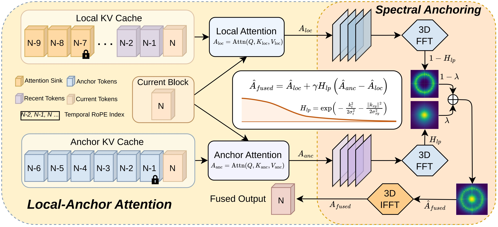

# FreqForcing: Autoregressive Long Video Generation via Spectral Self-Anchoring

[Jiatong Li](https://github.com/jiatongli2024), [Leo Liang](https://github.com/jiatongli2024/FreqForcing), [Linghe Kong](https://www.cs.sjtu.edu.cn/~linghe.kong/), and [Yulun Zhang](http://yulunzhang.com/)

"FreqForcing: Autoregressive Long Video Generation via Spectral Self-Anchoring", arXiv 2026

[](https://jiatongli2024.github.io/freqforcing.github.io/)
[](https://www.arxiv.org/abs/2508.04485)
[](https://github.com/jiatongli2024/FreqForcing/releases/download/v1/Supplementary_Material.pdf)
[](https://github.com/jiatongli2024/FreqForcing/releases)
[](https://github.com/jiatongli2024/FreqForcing)
[](https://github.com/jiatongli2024/FreqForcing/stargazers)

---

## 📚 Table of Contents

- [🔥 News](#-news)
- [📘 Abstract](#-abstract)
- [📝 Method Overview](#-method-overview)
- [📌 Citation](#-citation)

---

## 🔥 News

- 🚩 **[2026-07-28]** This repo is released.

## 📘 Abstract

> Autoregressive video diffusion models enable real-time streaming video generation. However, errors introduced during self-rollout accumulate over long horizons, manifesting as color drift, motion stagnation, and eventual visual collapse. In this paper, we characterize this phenomenon from a frequency-domain perspective: error accumulation appears as a pronounced energy drift in the low-frequency bands. We further investigate the effectiveness of attention sink in the frequency domain, and find that it improves the video quality by alleviating the spectral energy drift to some extent, but cannot fully resolve it. Motivated by the above analysis, we propose **FreqForcing**, a training-free framework that addresses error accumulation in long-video generation via Spectral Self-Anchoring (SSA). The proposed SSA leverages the low-frequency components of anchor attention to maintain long-horizon visual stability, while preserving dynamic motion through the high-frequency components of local attention. Our FreqForcing extends Self-Forcing pretrained on *5s* clips to two-minute generation, achieving $24\times$ extrapolation. Extensive experiments show that FreqForcing outperforms existing training-free methods quantitatively and qualitatively while remaining competitive with representative training-based approaches.

## 📝 Method Overview

<p align="center">
  
</p>

## TODO List

- [ ] Release inference code

## 📌 Citation  

If you find the code helpful in your research or work, please cite the following paper(s).

```
```


